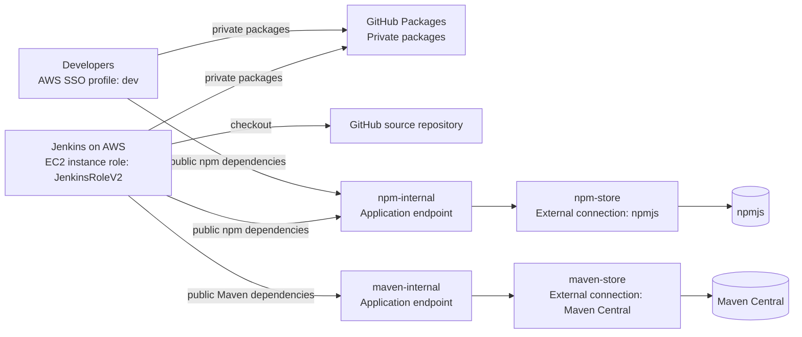

# AWS CodeArtifact runbook

## Purpose

This is the agreed package-management design for Tap Payments applications:

```text
Application / Docker build
        │
        ├── Private packages ──> GitHub Packages
        │
        └── Public npm/Maven dependencies ──> AWS CodeArtifact ──> npmjs / Maven Central
```

CodeArtifact is the controlled, AWS-hosted proxy and cache for public packages. GitHub Packages remains the private package registry. This preserves the existing private-package workflow and gives builds one audited source for public dependencies.

## Architecture diagram



The editable diagram source is [architecture.mmd](architecture.mmd). Import it into the diagrams.net/draw.io macro in Confluence, or export it as an image and upload it to the page.

## Executive summary (manager)

| Item | Decision |
| --- | --- |
| AWS account / region | `980136594430` / `us-east-1` |
| CodeArtifact domain | `tappayments` |
| Public npm path | `npm-internal` → `npm-store` → npmjs |
| Public Maven path | `maven-internal` → `maven-store` → Maven Central |
| Private packages | Continue using GitHub Packages |
| Jenkins credentials | EC2 instance role (`JenkinsRoleV2`); no static AWS key in Jenkins |
| Package credentials | Short-lived CodeArtifact token created per build |
| Container secret handling | Docker BuildKit secret mount; never Docker build arguments or image metadata |

The demo Jenkins build has passed for both npm and Maven. It proves public packages resolve through CodeArtifact and that Docker builds do not retain package tokens.

## Repository design

| Repository | Purpose | Connection / upstream | Who uses it |
| --- | --- | --- | --- |
| `npm-store` | Cache for public npm packages | External connection: `public:npmjs` | Upstream only |
| `npm-internal` | Application-facing npm endpoint | Upstream: `npm-store` | Developers and CI |
| `maven-store` | Cache for public Maven packages | External connection: `public:maven-central` | Upstream only |
| `maven-internal` | Application-facing Maven endpoint | Upstream: `maven-store` | Developers and CI |

Applications always use the `*-internal` repository. On the first request, CodeArtifact fetches the public package through the upstream chain and caches it in the corresponding `*-store` repository. Subsequent builds use the cache.

This is why public npm packages such as `lodash`, `axios`, and `dayjs` appear under **`npm-store`**, not `npm-internal`.

### Endpoints

```text
npm:   https://tappayments-980136594430.d.codeartifact.us-east-1.amazonaws.com/npm/npm-internal/
Maven: https://tappayments-980136594430.d.codeartifact.us-east-1.amazonaws.com/maven/maven-internal/
```

The trailing slash is required for the npm registry URL.

## SysOps setup

### Jenkins AWS agent

Attach the policy below to the EC2 instance role used by Jenkins (currently `JenkinsRoleV2`). The agent needs AWS CLI v2, Docker, and Docker BuildKit. It must reach the CodeArtifact API and repository endpoints.

Current pipeline read policy:

```json
{
  "Version": "2012-10-17",
  "Statement": [
    {
      "Sid": "GetCodeArtifactToken",
      "Effect": "Allow",
      "Action": "codeartifact:GetAuthorizationToken",
      "Resource": "arn:aws:codeartifact:us-east-1:980136594430:domain/tappayments"
    },
    {
      "Sid": "ReadPublicPackageProxies",
      "Effect": "Allow",
      "Action": [
        "codeartifact:GetRepositoryEndpoint",
        "codeartifact:ReadFromRepository"
      ],
      "Resource": [
        "arn:aws:codeartifact:us-east-1:980136594430:repository/tappayments/npm-internal",
        "arn:aws:codeartifact:us-east-1:980136594430:repository/tappayments/maven-internal"
      ]
    },
    {
      "Sid": "ExchangeTokenForCodeArtifact",
      "Effect": "Allow",
      "Action": "sts:GetServiceBearerToken",
      "Resource": "*",
      "Condition": {
        "StringEquals": {
          "sts:AWSServiceName": "codeartifact.amazonaws.com"
        }
      }
    }
  ]
}
```

`sts:GetServiceBearerToken` is required to exchange the instance-role credentials for a CodeArtifact authorization token.

If a future CI job publishes packages to CodeArtifact, add only to that dedicated publishing role:

```json
{
  "Effect": "Allow",
  "Action": [
    "codeartifact:PublishPackageVersion",
    "codeartifact:PutPackageMetadata"
  ],
  "Resource": "arn:aws:codeartifact:us-east-1:980136594430:package/tappayments/*"
}
```

Do not grant publishing to ordinary build agents.

### Developer access via IAM Identity Center

Developers use the `dev` AWS SSO profile and do not need AWS access keys. Assign an equivalent of the read-only policy above to the developer permission set. Use a separate, restricted role for CodeArtifact administration.

### Private-network agents

For AWS Jenkins agents with no outbound internet, create these VPC endpoints:

- `com.amazonaws.us-east-1.codeartifact.api` (interface)
- `com.amazonaws.us-east-1.codeartifact.repositories` (interface)
- Amazon S3 gateway endpoint for redirected package downloads

The agent also needs a controlled route to source control and base images. For fully isolated environments, use an approved proxy or mirror GitHub/base images into an internal service such as ECR.

## Developer guide: local build with AWS SSO

### Prerequisites

- AWS CLI v2
- Node.js/npm for npm projects and/or Java/Maven for Maven projects
- IAM Identity Center access through profile `dev`

Authenticate and confirm the active identity:

```powershell
aws sso login --profile dev
aws sts get-caller-identity --profile dev --region us-east-1
```

The account must be `980136594430`. When the SSO session expires, run `aws sso login --profile dev` again.

### npm projects

For a normal local development session:

```powershell
aws codeartifact login `
  --tool npm `
  --domain tappayments `
  --domain-owner 980136594430 `
  --repository npm-internal `
  --region us-east-1 `
  --profile dev

npm ping
npm install
```

`aws codeartifact login` updates the local `~/.npmrc` and the authorization token lasts up to 12 hours. It changes the default npm registry. For projects requiring GitHub Packages for private scoped packages, preserve the GitHub scope configuration and route unscoped public packages to CodeArtifact:

```ini
@tap-payments:registry=https://npm.pkg.github.com/
registry=https://tappayments-980136594430.d.codeartifact.us-east-1.amazonaws.com/npm/npm-internal/
```

Never commit an authentication token in `.npmrc`.

To verify npm is actually using CodeArtifact:

```powershell
npm config get registry
npm --loglevel=http install lodash axios dayjs
```

Expected registry:

```text
https://tappayments-980136594430.d.codeartifact.us-east-1.amazonaws.com/npm/npm-internal/
```

### Maven projects

Create a fresh token in the current PowerShell session:

```powershell
$env:CODEARTIFACT_AUTH_TOKEN = aws codeartifact get-authorization-token `
  --domain tappayments `
  --domain-owner 980136594430 `
  --region us-east-1 `
  --profile dev `
  --query authorizationToken `
  --output text
```

Add this to the existing Maven `settings.xml`. Keep all existing GitHub Packages `<server>` entries unchanged:

```xml
<servers>
  <!-- Existing GitHub Packages server remains here. -->
  <server>
    <id>codeartifact-central</id>
    <username>aws</username>
    <password>${env.CODEARTIFACT_AUTH_TOKEN}</password>
  </server>
</servers>
<mirrors>
  <mirror>
    <id>codeartifact-central</id>
    <url>https://tappayments-980136594430.d.codeartifact.us-east-1.amazonaws.com/maven/maven-internal/</url>
    <mirrorOf>central</mirrorOf>
  </mirror>
</mirrors>
```

Then build as usual:

```powershell
mvn -s settings.xml clean verify
```

`mirrorOf` is `central`, so Maven Central dependencies resolve through CodeArtifact while GitHub Packages/private repository definitions remain unchanged.

## Jenkins integration

### Job configuration

| Jenkins setting | Value |
| --- | --- |
| Definition | Pipeline script from SCM |
| Repository URL | `https://github.com/farhanali67/demo.git` |
| Branch | `*/main` |
| Script path | `Jenkinsfile.codeartifact-demo` |
| Agent label | `Dev` |

### Pipeline sequence

1. Verifies that the EC2 instance role is active using `aws sts get-caller-identity`.
2. Gets a temporary CodeArtifact token with `--duration-seconds 0`; it is bound to the current IAM role session.
3. Creates temporary npm and Maven configuration files.
4. Mounts them into Docker only as BuildKit secrets.
5. Builds/runs npm first, then Maven.
6. Deletes the temporary configuration files at the end of the stage.

The token is not passed using `--build-arg`, not stored as a Jenkins credential, and not retained in a Docker image.

Expected successful output:

```text
lodash, axios, and dayjs resolved through CodeArtifact successfully.
Maven dependency resolved through CodeArtifact successfully.
Finished: SUCCESS
```

The npm Dockerfile uses `--loglevel=http`, so the Jenkins log displays the CodeArtifact registry URL used for package retrieval.

## Docker secret rule

Never use this pattern for a CodeArtifact or GitHub token:

```dockerfile
ARG token
```

Build arguments can be exposed through image history, build logs, cache metadata, or downstream systems. Use BuildKit secrets:

```bash
DOCKER_BUILDKIT=1 docker build --secret id=npmrc,src=/path/to/temp.npmrc .
```

```dockerfile
RUN --mount=type=secret,id=npmrc,target=/root/.npmrc npm ci --no-progress
```

## Validation and troubleshooting

### Console validation

Public npm packages cached by the proxy appear here:

```text
CodeArtifact → tappayments → npm-store → Packages
```

Public Maven packages cached by the proxy appear here:

```text
CodeArtifact → tappayments → maven-store → Packages
```

### Common issues

| Symptom | Cause | Resolution |
| --- | --- | --- |
| `AccessDenied` for `GetAuthorizationToken` | Missing CodeArtifact permission | Add domain-scoped token permission and STS bearer-token permission. |
| `AccessDenied` for `sts:GetServiceBearerToken` | Required STS action missing | Add the constrained STS statement in the read policy. |
| npm `401`/`403` | Token or SSO session expired | Run `aws sso login`, then `aws codeartifact login` again. |
| npm package not found | Incorrect repository/upstream | Use `npm-internal`; verify its upstream is `npm-store`. |
| Maven contacts Maven Central directly | Maven mirror not active | Add the `codeartifact-central` mirror to the settings file used by Maven. |
| Jenkins cannot get AWS identity | Instance role unavailable | Attach the read policy to the instance role and check instance metadata/network access. |

## Security rules

- Use IAM roles and IAM Identity Center, never static AWS access keys.
- Create a CodeArtifact token only when needed; it expires after at most 12 hours.
- Do not commit tokens, `.npmrc` credentials, or Maven passwords.
- Do not pass tokens using Docker build arguments.
- Keep Jenkins read-only. Use a separate role for publishing.
- Keep GitHub Packages credentials separate from AWS credentials.
- Enable CloudTrail auditing for CodeArtifact and IAM activity.

## Publishing this runbook to Confluence

1. Create a page named **AWS CodeArtifact — Package Proxy and Jenkins Integration**.
2. Insert the architecture diagram at the top using the Confluence diagrams.net/draw.io macro and import [`architecture.mmd`](architecture.mmd). If that macro is unavailable, export the diagram as PNG/SVG from diagrams.net and upload it.
3. Copy this document from **Executive summary** through **Security rules** into the page. The headings work as a Confluence page hierarchy, and the IAM policy must remain in a code block.
4. Restrict edit access to Platform/SysOps owners; grant view access to engineering and managers.
5. Link the Confluence page back to this repository so commands, policies, and the diagram source remain version-controlled.

## References

- [AWS: Configure and use npm with CodeArtifact](https://docs.aws.amazon.com/codeartifact/latest/ug/npm-auth.html)
- [AWS: CodeArtifact authentication and tokens](https://docs.aws.amazon.com/codeartifact/latest/ug/tokens-authentication.html)
- [AWS: IAM Identity Center authentication with the AWS CLI](https://docs.aws.amazon.com/cli/latest/userguide/cli-configure-sso.html)
- [AWS: How CodeArtifact works with IAM](https://docs.aws.amazon.com/codeartifact/latest/ug/security_iam_service-with-iam.html)
